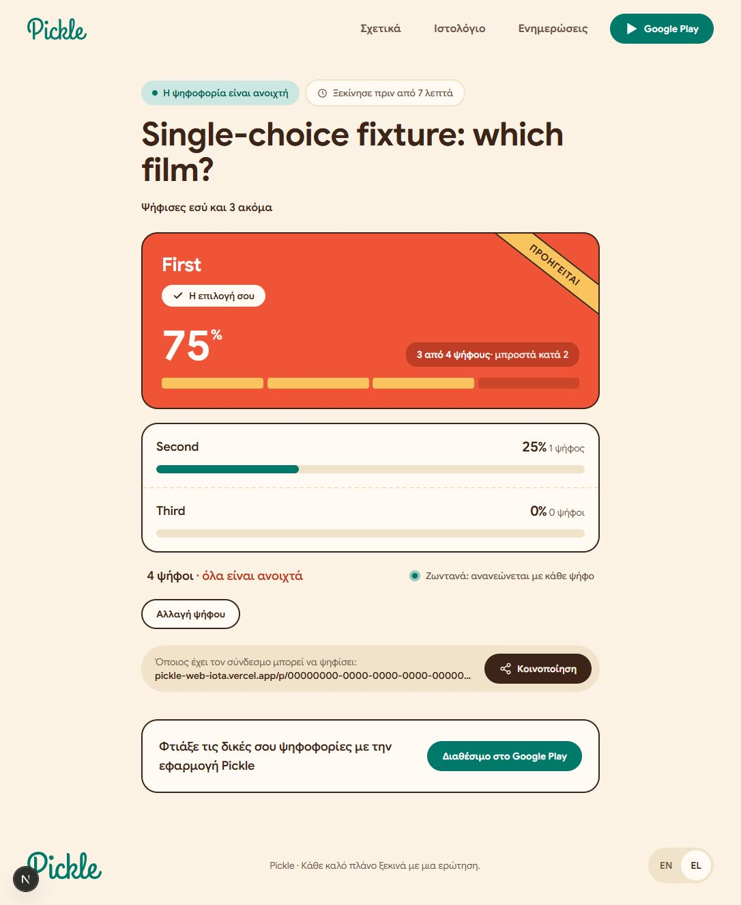

# Shared-client validation (15 October 2026)

The web client now restores complete ballot sets, uses accessible radio controls
for single choice and independently focusable checkboxes for multiple choice,
and submits complete replacements through `cast_ballot`. Results use voters as
the percentage denominator and show selections separately. English and Greek
strings are included. Stable option ordering uses position, creation time, and ID.

Validation:

- `npm test`: 26 tests passed after merging current master (poll logic, API contract/failures, controls and counts).
- `npm run lint`: passed.
- `npm run build`: passed; Google Sans fallback-metadata warning is nonfatal.
- Browser fixture checks: single submission, Keep my vote, multiple submission and
  replacement, restored selections, voter totals, and locale switching.
- Both `stability_rollback.sql` and `templates_ballots_rollback.sql` passed through
  Supabase MCP with all fixtures rolled back, after the deployed migrations.
- Extended local concurrency harness: syntax checked, not run (no local Postgres,
  Docker, or psql on the implementation machine).

The Android implementation has Home, starter/personal templates, saved drafts,
weekly deadlines, and multi-choice voting. Its JVM suite has 74 passing tests,
and eleven device instrumentation checks passed. A full authenticated OS process-kill
restoration cycle and a deployed cross-client multi-choice smoke test remain
release acceptance checks. The browser checks used only the in-memory fixture
backend and never submitted real user ballots.

Database migrations are already applied. Review and release this compatible web
client before distributing Android. No merge or production rollout is included.
The checked build used dummy loopback fixture environment values; deployment must
use the project's real public Supabase URL/key described in the README.

The upstream lockfile had omitted Rolldown platform-binding metadata. Existing
exact-version entries were restored, with no dependency version upgrades in this
patch. Windows npm additionally required a local optional-native-binding install
for the final test run. The existing npm audit reports seven affected packages
through the braces denial-of-service advisory; remediation remains separate.

The full schema snapshot, versioned migrations, and advisor summary are retained
in this repository. See [database contracts](database.md) for ownership, ballot,
retry, and template-round guarantees and the remaining advisor follow-ups.

